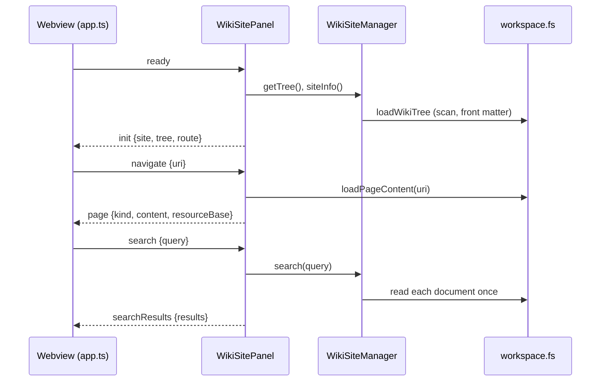

# Wiki Site

The Wiki Site presents the documents the sidebar tree shows as a documentation site in an editor tab: a header with the workspace name, logo, and search; a navigation tree; breadcrumbs; the rendered page; and an "On this page" outline. It runs entirely inside VS Code, on desktop and in VS Code for the Web, and makes no network requests of its own.

## Implementation

The site has an extension-host half and a webview half, joined by the messages in [`src/site/protocol.ts`](../../src/site/protocol.ts).

| Module                                                                                                             | Runs in        | Role                                                                                                     |
| ------------------------------------------------------------------------------------------------------------------ | -------------- | -------------------------------------------------------------------------------------------------------- |
| [`sitePanel.ts`](../../src/site/sitePanel.ts)                                                                      | Extension host | `WikiSiteManager` owns the tabs, the shared tree, and search; `WikiSitePanel` answers one tab's messages |
| [`pageContent.ts`](../../src/site/pageContent.ts)                                                                  | Extension host | Classifies a file and reads it through `workspace.fs`                                                    |
| [`search.ts`](../../src/site/search.ts)                                                                            | Extension host | `SearchIndex`, which reads document text on the first search and keeps it until a refresh                |
| [`searchDocs.ts`](../../src/site/searchDocs.ts)                                                                    | Both           | Ranking and snippets, free of the `vscode` module so the Cypress harness runs the same code              |
| [`links.ts`](../../src/site/links.ts)                                                                              | Extension host | Resolves a link written in a page to a wiki page, a workspace file, or an external URL                   |
| [`branding.ts`](../../src/site/branding.ts)                                                                        | Extension host | Finds the logo for the header and tab                                                                    |
| [`webview/app.ts`](../../src/site/webview/app.ts)                                                                  | Webview        | The page: header, navigation, routing and history, outline, search box and results                       |
| [`webview/render.ts`](../../src/site/webview/render.ts)                                                            | Webview        | Renders Markdown with markdown-it, sanitizes with DOMPurify, highlights with highlight.js                |
| [`webview/pdf.ts`](../../src/site/webview/pdf.ts), [`webview/pdf/viewer.ts`](../../src/site/webview/pdf/viewer.ts) | Webview        | Loads the pdf.js bundle on the first PDF page and draws each page to a canvas                            |
| [`webview/mermaid.ts`](../../src/site/webview/mermaid.ts)                                                          | Webview        | Loads Mermaid on the first page that has a diagram                                                       |
| [`webview/helpers.ts`](../../src/site/webview/helpers.ts)                                                          | Webview        | DOM-free logic: link classification, slugs, image paths, history, suggestions                            |
| [`webview/site.css`](../../src/site/webview/site.css)                                                              | Webview        | Layout and the four themes                                                                               |

The tree comes from [`loadWikiTree`](../../src/tree/loadWikiTree.ts), the same function the sidebar's [`WorkspaceWikiTreeProvider`](../../src/tree/treeProvider.ts) calls, so both list the same documents, in the same order, under the same titles.

[`esbuild.js`](../../esbuild.js) builds the webview into `dist/webview/`: `site.js`, `site.css`, the pdf.js viewer as `pdf.js`, and a copy of Mermaid's browser bundle as `mermaid.js`. The last two load only on pages that need them.

## Opening the site

- **Open Wiki Site** (`workspace-wiki.openSite`), in the Workspace Wiki view's title bar and the Command Palette, opens the home page: the top-level README, or a list of top-level sections when there is none.
- **Open in Wiki Site** (`workspace-wiki.openInSite`), on a file's right-click menu in the sidebar, opens that file's page.

A second open reveals the existing tab. A new tab opens only on request, from a middle click or the right-click menu.

## Page kinds

[`classifyFile`](../../src/site/pageContent.ts) decides how a file is shown from its name:

| Kind       | Files                                                                     | Shown as                                                                  |
| ---------- | ------------------------------------------------------------------------- | ------------------------------------------------------------------------- |
| `markdown` | `.md`, `.markdown`, `.mdx`, `.qmd`, `.rmd`, extensionless `README`        | Rendered Markdown, front matter removed, Mermaid fences drawn as diagrams |
| `html`     | `.html`, `.htm`, `.xhtml`                                                 | The document body, sanitized                                              |
| `image`    | `.png`, `.jpg`, `.jpeg`, `.gif`, `.svg`, `.webp`, `.bmp`, `.ico`, `.avif` | The image                                                                 |
| `pdf`      | `.pdf`                                                                    | Every page drawn to a canvas, with the page count                         |
| `binary`   | Office, archive, media, and font formats                                  | A note offering **Open preview** and **Edit source**                      |
| `code`     | Everything else, such as `.txt`, `doc.go`, `.ts`, `.json`                 | Highlighted source, by the file's extension                               |

A file classified as text that holds a NUL byte in its first 8,000 bytes is shown as binary. Only the first 1 MB of a text file is rendered, with a note saying so.

Images and PDFs are not read by the host: the page carries `fileSrc`, the file's webview URI, and the webview loads it. PDFs are drawn by the legacy build of [pdf.js](https://github.com/mozilla/pdf.js), whose polyfills cover the older Chromium in the VS Code versions this extension supports; the modern build calls `Uint8Array.prototype.toHex`, which needs Chromium 140. A webview cannot start a worker from an extension resource, so pdf.js's worker code is bundled with it and runs on the page's thread. Each page is drawn when it comes within 600 px of the view, at the page width and the screen's pixel density. A PDF that fails to load says so and leaves the open buttons.

A document whose first element is an `<h1>` keeps it as the page title. Otherwise the site shows the tree's title.

## Interactions

| Action                                            | Result                                                                                                                                                                                                                        |
| ------------------------------------------------- | ----------------------------------------------------------------------------------------------------------------------------------------------------------------------------------------------------------------------------- |
| Click a navigation entry or page link             | Shows the page in this tab                                                                                                                                                                                                    |
| Middle click, or Ctrl/Cmd+click, on a page        | Opens it in a new Wiki Site tab                                                                                                                                                                                               |
| Double click a navigation entry                   | Opens the source file in the text editor, as a double click in the sidebar does                                                                                                                                               |
| **Open preview** / **Edit source**                | Opens the source file with `openWith` / in the text editor                                                                                                                                                                    |
| Click an external link (VS Code's own handling)   | Opens it in the default browser (`env.openExternal`)                                                                                                                                                                          |
| Middle click an external link                     | Opens it in a new tab of VS Code's integrated browser (`workbench.action.browser.open`); where VS Code has no integrated browser, in the Simple Browser (`simpleBrowser.api.open`); where it has neither, the default browser |
| Click a link to a workspace file outside the wiki | Opens the file in its editor                                                                                                                                                                                                  |
| Right click a page or link                        | VS Code's menu with the commands below                                                                                                                                                                                        |
| `/` or Ctrl/Cmd+K                                 | Focuses search                                                                                                                                                                                                                |
| Alt+Left / Alt+Right                              | Back / forward                                                                                                                                                                                                                |

The right-click menu is contributed to `webview/context` in [`package.json`](../../package.json). Each element carries a `data-vscode-context` naming either a page (`webviewSection: "doc"`) or an external link (`webviewSection: "external"`):

- On a page: **Open in New Tab**, **Open to the Side**, **Open Original File**, **Edit Source**, **Copy Relative Path**.
- On an external link: **Open in Default Browser**, **Open in Integrated Browser**, **Copy Link Address**.

A link written in a page carries its raw `href` and the page it is on, and the command resolves it with the same [`resolveDocLink`](../../src/site/links.ts) a click uses.

## Links

[`resolveDocLink`](../../src/site/links.ts) resolves a relative path against the page's folder and a leading `/` against its workspace folder. A link to a folder lands on its README, else its index file. Only `uri.path` is rewritten, so links keep working on `vscode-vfs://` and other virtual file systems.

Relative image paths resolve in the webview against `resourceBase`, the webview URI of the page's folder, and `/`-rooted paths against `rootBase`, its workspace folder.

## Search

Typing in the search box suggests pages by title and path from the tree already in the webview. Enter opens the results page, which asks the host to search the text of every page.

[`SearchIndex`](../../src/site/search.ts) reads the documents on the first search, eight at a time, and keeps their plain text until the site refreshes; a saved document is re-read on its own. [`searchDocs`](../../src/site/searchDocs.ts) requires every term, case-insensitively, in the title, path, or text, and ranks title hits above path hits above body hits. Results carry plain text and match offsets; the webview builds the highlighting with `textContent` and `<mark>`, so result text is never parsed as HTML.

## Branding and themes

[`findSiteBranding`](../../src/site/branding.ts) picks two images: a logo for the header and an icon for the tab.

- `workspaceWiki.site.logo` is used when that file can be read: always as the logo, and as the tab icon when its format is one a tab can show.
- Otherwise the workspace is searched for files named `favicon`, `logo`, `icon`, or `apple-touch-icon`, with or without a suffix such as `-32x32` or `@2x`, at most three folders deep. Dependency and build folders, dot-folders other than `.github` (such as `.next`), and `excludeGlobs` are skipped.
- Candidates rank favicon over logo over icon over apple-touch-icon, the exact name over a suffixed one, then by format, then the shallowest path.
- The logo accepts `.svg`, `.png`, `.ico`, `.webp`, `.jpg`, `.jpeg`, and `.gif`. The tab icon accepts the same without `.ico`: desktop VS Code serves a workspace file to its own interface only with `.svg`, `.png`, `.jpg`, `.jpeg`, `.gif`, `.bmp`, or `.webp` (`validExtensions` in VS Code's `protocolMainService.ts`). A workspace whose favicon is `favicon.ico` therefore shows it in the header and, if it also has one, a PNG favicon on the tab.
- With no usable tab icon, or on a scheme other than `file` or `vscode-remote`, the tab shows the Workspace Wiki icon: [`media/icon-light.svg`](../../media/icon-light.svg) in light themes and [`media/icon-dark.svg`](../../media/icon-dark.svg) in dark ones.

`workspaceWiki.site.theme` picks the palette: `vscode` maps every colour to the active VS Code theme; `paper`, `slate`, and `lagoon` are fixed light, dark, and teal-header palettes. High-contrast VS Code themes always use `vscode`.

`workspaceWiki.site.customCss` loads stylesheets after the theme. Theme selectors use `:where()`, so a rule on `.wiki` in a custom stylesheet overrides them:

```css
.wiki {
	--wiki-accent: #8a3ffc;
	--wiki-content-width: 52rem;
	--wiki-font-body: 'IBM Plex Sans', system-ui, sans-serif;
}
```

The variables are `--wiki-bg`, `--wiki-fg`, `--wiki-muted`, `--wiki-border`, `--wiki-accent`, `--wiki-header-bg`, `--wiki-header-fg`, `--wiki-nav-bg`, `--wiki-code-bg`, `--wiki-font-body`, `--wiki-font-code`, `--wiki-content-width`, `--wiki-nav-width`, and `--wiki-toc-width`, among others listed at the top of [`site.css`](../../src/site/webview/site.css).

## Security

- The webview's Content Security Policy allows scripts only with a per-load nonce; images from the extension, the workspace, `https:`, `data:`, and `blob:` (pdf.js draws some PDF images through `blob:` URLs); styles from the extension and inline (Mermaid writes inline styles into its diagrams); and `fetch` only from the extension and the workspace, which pdf.js uses to read a PDF.
- `localResourceRoots` is the extension's `dist/webview` and `media` folders plus the workspace folders.
- Markdown and HTML pass through DOMPurify, which removes scripts, event handlers, and `javascript:` URLs; `<style>`, `<form>`, `<iframe>`, `<object>`, `<embed>`, `<base>`, `<meta>`, and `<link>` are removed as well.
- Mermaid runs with `securityLevel: 'strict'`.
- The host type-checks every webview message with `parseViewMessage`, serves page contents only for URIs in the wiki tree, and opens external links only for `http`, `https`, `mailto`, `tel`, and `ftp`.

## Keeping current

- A `workspaceWiki` setting change or the **Refresh** command calls `WikiSiteManager.refresh`, which reloads the tree, logo, and settings into every tab.
- Saving a document re-reads its search text and re-renders it in any tab showing it.
- A tab's history and expanded folders are saved with the webview's `setState`, so a tab moved to the background and back returns to the same page.

## Message flow



## Testing

- Jest covers the host modules and the webview helpers beside each file, for example [`sitePanel.test.ts`](../../src/site/sitePanel.test.ts) and [`helpers.test.ts`](../../src/site/webview/helpers.test.ts).
- [`extension.e2e.test.ts`](../../src/extension.e2e.test.ts) and the [web suite](../../src/test/web/index.ts) open the site in desktop VS Code and in the browser host.
- Cypress drives the webview itself through a standalone harness; see [Testing](../usage/testing.md#wiki-site-webview-tests-cypress).
