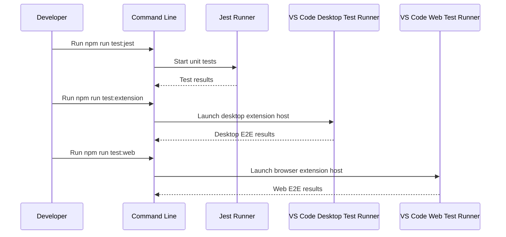

# Testing Guide

This guide explains how to run and write tests for the Workspace Wiki extension.

## Test Types

- **Unit Tests**: Test individual functions and modules (Jest).
- **Desktop E2E Tests**: Validate extension behavior in a running VS Code instance (`@vscode/test-electron`).
- **Web E2E Tests**: Validate extension behavior in a browser extension host (`@vscode/test-web`). This is the only place the extension runs in a browser, so a runtime web regression surfaces here rather than in the unit or desktop suites.
- **Wiki Site Webview Tests**: Drive the [Wiki Site](../architecture/wiki-site.md) page in a browser with Cypress, against a fake extension host. Cypress cannot drive VS Code itself, so this is where clicks, rendering, search, themes, and accessibility of the site are tested.

## Running Tests

- **Unit tests:**

    ```sh
    npm run test:jest
    ```

- **Desktop E2E tests:**

    ```sh
    npm run test:extension
    ```

- **Web E2E tests:**

    ```sh
    npm run test:web
    ```

    Runs headless Chromium against the [`example`](../../example/README.md) workspace. To open the same environment interactively, run `npm run run-in-browser`.

    Both scripts download a VS Code build on first use, roughly 53 MB, into `.vscode-test-web`. `npm run validate` includes the web suite, so it carries that cost too.

- **Wiki Site webview tests:**

    ```sh
    npm run test:cypress
    ```

    Builds the harness, serves it on port 5179, and runs every spec headless in Electron. `npm run test:cypress:open` opens the Cypress app on the same harness instead.

- **Watch mode:**

    ```sh
    npm run watch-tests
    ```

- **All tests (validation):**

    ```sh
    npm run validate
    ```

## Test Locations

- Unit tests: `src/**/*.test.ts`
- Desktop E2E tests: `src/**/*.e2e.test.ts`
- Web E2E tests: [`src/test/web/index.ts`](../../src/test/web/index.ts), driven by the runner in [`src/test/web/runner.ts`](../../src/test/web/runner.ts)
- Wiki Site webview tests: `cypress/e2e/*.cy.ts`, with commands in [`cypress/support/commands.ts`](../../cypress/support/commands.ts)
- Test utilities: `src/test/`

## Wiki Site Webview Tests (Cypress)

The specs run against a standalone harness, not VS Code. [`src/site/webview/harness/harness.ts`](../../src/site/webview/harness/harness.ts) starts the real webview app with a fake host that answers its messages from [`fixtures.ts`](../../src/site/webview/harness/fixtures.ts) and uses the extension's own search ranking. `node esbuild.js --harness` builds it into `out/harness/`, and `--serve` serves that folder. The harness page sets the same Content Security Policy the extension does, so a change that would break under it fails here too.

The harness reads URL parameters:

| Parameter   | Values                               | Effect                                            |
| ----------- | ------------------------------------ | ------------------------------------------------- |
| `fixture`   | `default`, `noReadme`, `empty`       | Which tree the fake host serves                   |
| `theme`     | `vscode`, `paper`, `slate`, `lagoon` | The `workspaceWiki.site.theme` value              |
| `vscode`    | `light`, `dark`, `hc`                | The VS Code theme kind the page pretends to have  |
| `customCss` | `1`                                  | Loads a fixture user stylesheet                   |
| `logo`      | `0`                                  | Sends no logo                                     |
| `page`      | A workspace-relative path            | Opens on that page, as **Open in Wiki Site** does |

Specs drive it through four commands: `cy.openSite(params)`, `cy.hostSends(message)` to play a host message, `cy.hostReceived(type)` to read what the webview posted (it retries with the assertions chained after it), and `cy.a11yCheck()` to run axe. `byTestId(id)` builds a `[data-testid]` selector.

| Spec                                                               | Covers                                                                                  |
| ------------------------------------------------------------------ | --------------------------------------------------------------------------------------- |
| [`navigation.cy.ts`](../../cypress/e2e/navigation.cy.ts)           | Tree order, folders, breadcrumbs, history, landing page, narrow layouts                 |
| [`rendering.cy.ts`](../../cypress/e2e/rendering.cy.ts)             | Markdown, outline, code, Mermaid, images, PDFs, HTML, binaries, sanitizing, live reload |
| [`links.cy.ts`](../../cypress/e2e/links.cy.ts)                     | Left, middle, Ctrl and double clicks, anchors, open buttons, right-click menu context   |
| [`search.cy.ts`](../../cypress/e2e/search.cy.ts)                   | Suggestions, results, highlighting, shortcuts                                           |
| [`branding-themes.cy.ts`](../../cypress/e2e/branding-themes.cy.ts) | Logo, name, the four themes, high contrast, custom stylesheets                          |
| [`accessibility.cy.ts`](../../cypress/e2e/accessibility.cy.ts)     | axe on pages in every theme, search results, and the landing page                       |

`cypress-axe` injects axe with `eval`, which the harness's policy forbids, so `cy.a11yCheck()` loads the `axe.min.js` the harness build copies beside the page instead.

The Cypress specs have their own [`cypress/tsconfig.json`](../../cypress/tsconfig.json), which extends the root one and adds Cypress's types; `npm run check-types` checks both. A terminal inside VS Code inherits `ELECTRON_RUN_AS_NODE=1`, which stops Cypress's Electron from starting, so the scripts run through [`scripts/runWithoutElectronNode.mjs`](../../scripts/runWithoutElectronNode.mjs), which removes it.

## Jest Types in TypeScript Tests

Avoid triple-slash Jest references and extra `tsconfig` files. Jest globals are
available via the root `tsconfig.json` `types` entry, so tests can use
`describe`, `it`, `test`, and `expect` directly.

## Unit Test Coverage

**Tree Module Tests:**

- [`src/tree/buildTree.test.ts`](../../src/tree/buildTree.test.ts): Tests for file name normalization and tree building logic
- [`src/tree/treeProvider.test.ts`](../../src/tree/treeProvider.test.ts): Tests for WorkspaceWikiTreeProvider class methods

**Scanner Module Tests:**

- [`src/scanner/workspaceScanner.test.ts`](../../src/scanner/workspaceScanner.test.ts): Tests for workspace file scanning and filtering
- [`src/scanner/gitignore.test.ts`](../../src/scanner/gitignore.test.ts): Tests for `.gitignore` negation, parent exclusion, anchoring, nested overrides, multi-root isolation, and virtual file system schemes

**Extension Tests:**

- [`src/extension.test.ts`](../../src/extension.test.ts): Tests for main extension functionality and integration

**E2E Tests:**

- [`src/extension.e2e.test.ts`](../../src/extension.e2e.test.ts): End-to-end tests for extension behavior in VS Code
- [`src/test/web/index.ts`](../../src/test/web/index.ts): Web extension host smoke tests, executed through the lightweight runner in [`src/test/web/runner.ts`](../../src/test/web/runner.ts)

## Example Directory for Testing

The `example/` directory contains a variety of files and folders used to test and demonstrate the Workspace Wiki extension's features. Use these files to verify:

- File type support and filtering (see `file-types-test/`)
- Handling of ignored and hidden files (see `ignore-files-test/`)
- Tree structure, index/README handling, and nested folders

You can toggle extension settings (such as `showHiddenFiles`) and observe how the Workspace Wiki tree updates to reflect these changes using the files in `example/`.

## Example Unit Test

```ts
import { normalizeTitle } from '@tree';

test('normalizeTitle converts file names to titles', () => {
	expect(normalizeTitle('userGuide.md')).toBe('User Guide');
	expect(normalizeTitle('api-reference.md')).toBe('Api Reference');
});
```

## Example E2E Test

```ts
import * as vscode from 'vscode';

test('Workspace Wiki tree appears', async () => {
  const tree = vscode.window.createTreeView('workspaceWiki', { treeDataProvider: ... });
  expect(tree).toBeDefined();
});
```

## Test Workflow Diagram



This diagram shows the flow for running unit, desktop E2E, and web E2E tests.
